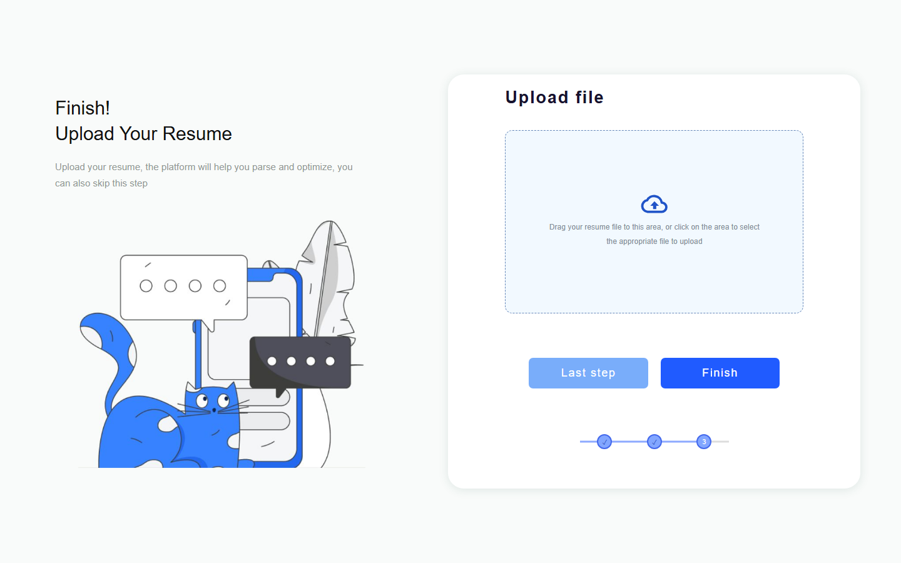

# Upload Your Resume · 简历上传页

**[打开在线演示 ↗](https://babymoon784.github.io/resume-upload-ui/)** · [查看 Figma 原稿](https://www.figma.com/design/D0jjN7Twkq0DGm3ZJvQabz/?node-id=0-1)

点击「打开在线演示」即可体验。把一份 PDF 拖进浅蓝色上传区，点击 **Preview file** 可预览简历。缩窄浏览器窗口，可以看到蓝猫随布局移动，上传卡片切换到介绍文字下方。文件仅在当前浏览器中处理。

## 离线查看

- **只下载一个文件**：打开[独立离线版](https://github.com/BabyMoon784/resume-upload-ui/blob/main/docs/resume-upload-offline.html)，点击 GitHub 文件页右上方的 **Download raw file**（下载图标），保存后双击即可。这个文件已内嵌样式、脚本和蓝猫插画。
- **查看完整源码**：下载[完整项目 ZIP](https://github.com/BabyMoon784/resume-upload-ui/archive/refs/heads/main.zip)，解压整个压缩包，再打开项目根目录的 `index.html`。**根目录的 `index.html` 依赖同目录下的 `styles.css`、`app.js` 和 `assets/`。单独下载它会丢失样式、插画和交互。**

## 实现与交互

页面采用 HTML、CSS 和原生 JavaScript 实现，无需安装依赖或执行构建。

- 点击、键盘选择或拖放均可添加简历。选中后显示文件名，再选一次即可替换。一次拖入多个文件时会提示选择一份。
- PDF、常见图片和纯文本支持本地预览，按 Esc 或 Close 可关闭。Word 文件可选择并显示文件名。
- 桌面采用双栏布局，宽度不超过 760px 时改为上下排列。按钮支持悬停、按下和键盘焦点状态。
- Last step 可返回上一步说明，返回上传页后会保留已选文件。Finish 可带文件完成，也可跳过上传。
